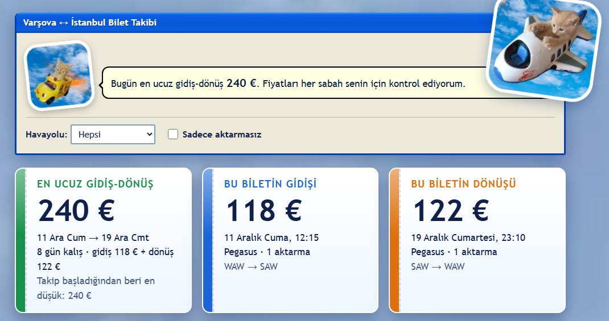
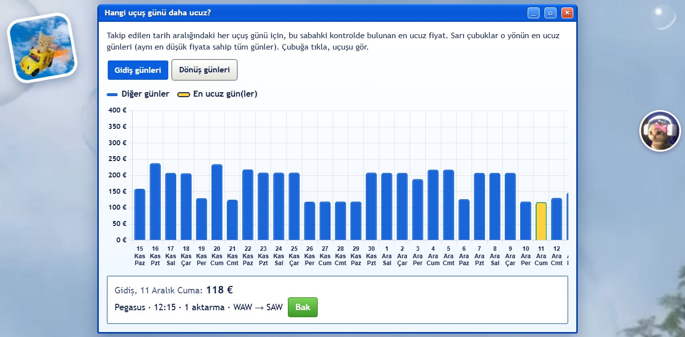
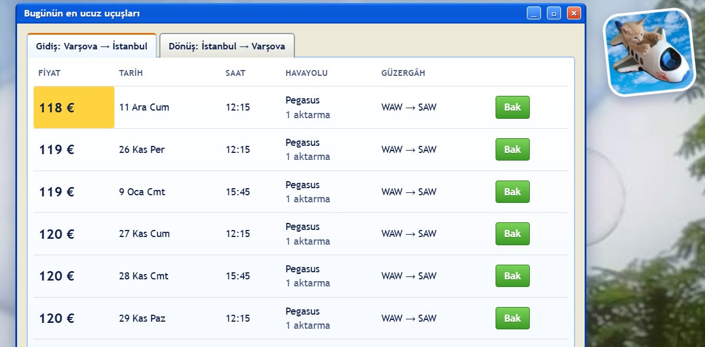

# Varşova ↔ İstanbul Bilet Takibi

Varşova ile İstanbul arasındaki THY, LOT ve Pegasus biletlerini her sabah kontrol eden küçük bir site.
En ucuz gidiş-dönüşü, fiyat geçmişini ve hangi günün daha ucuz olduğunu grafiklerle gösterir.

- Fiyatlar her sabah GitHub Actions ile Google Flights'tan otomatik çekilir ve `data/history.json` dosyasına eklenir.
- Site GitHub Pages üzerinden yayınlanır. Ücretsizdir, API anahtarı gerekmez.
- Fiyatlar tek kişi içindir ve bagaj içermeyebilir. Satın almadan önce sitedeki "Bak" düğmesiyle güncel fiyata bakın.

## Ekran görüntüleri

**En ucuz gidiş-dönüş**



**Hangi uçuş günü daha ucuz?** Sarı çubuklar en ucuz günler. Çubuğa tıklayınca uçuşun detayı görünür.



**Bugünün en ucuz uçuşları**



## Ayarlar (`config.json`)

| Alan | Ne işe yarar |
|---|---|
| `outbound_dates`, `return_dates` | Taranan gidiş ve dönüş tarih aralıkları |
| `origins`, `destinations` | Havalimanları (WAW; IST ve SAW) |
| `airlines` | Takip edilen havayolları |
| `min_stay_days`, `max_stay_days` | Gidiş-dönüş için en az ve en çok kalış günü |

## Bilgisayarda çalıştırma

```bash
pip install -r requirements.txt
python scripts/fetch.py   # fiyatları çek
python serve.py           # http://localhost:8765
```
